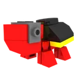

# Tortoise Pet - quest/objective source LOT 5640

<!-- media:start (generated by scripts/build_media.py) -->
{ .lu-icon .lu-on-light width="128" loading="lazy" }
<!-- media:end -->

[Quest database](../README.md) | [Methodology](../Methodology.md)

Item acquisition: [Tortoise Pet (LOT 5640)](../../items/5640.md).

## Candidate placements / spawner waypoints

Coordinates are static map XYZ, not confirmed live NPC positions. Multiple scene objects and waypoints may refer to a shared spawn mechanism; counts are not population estimates. Feature gates and disabled auto-spawning are retained, and client-only objects are excluded.

| Zone | X | Y | Z | Origin | Conditions |
| --- | --- | --- | --- | --- | --- |
| [Gnarled Forest Deep Dive Map (375)](../locations/zone-375.md) | -198.977 | 249.728 | -314.05 | Scene nd&#95;gnarled&#95;forest&#95;9&#95;start.lvl (Start), layer 0; LOT 176 spawner | Automatic spawning disabled; trigger/script may be required |
| [Gnarled Forest Deep Dive Map (375)](../locations/zone-375.md) | -149.327 | 254.451 | -279.749 | Scene nd&#95;gnarled&#95;forest&#95;9&#95;start.lvl (Start), layer 0; LOT 176 spawner | Automatic spawning disabled; trigger/script may be required |
| [Gnarled Forest (1300)](../locations/zone-1300.md) | -198.977 | 249.728 | -314.05 | Scene nd&#95;gnarled&#95;forest&#95;9&#95;start.lvl (Start), layer 0; LOT 176 spawner | Automatic spawning disabled; trigger/script may be required |
| [Gnarled Forest (1300)](../locations/zone-1300.md) | -149.327 | 254.451 | -279.749 | Scene nd&#95;gnarled&#95;forest&#95;9&#95;start.lvl (Start), layer 0; LOT 176 spawner | Automatic spawning disabled; trigger/script may be required |
