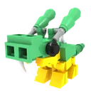

# Green Dragon Pet - quest/objective source LOT 5641

<!-- media:start (generated by scripts/build_media.py) -->
{ .lu-icon .lu-on-dark width="128" loading="lazy" }
<!-- media:end -->

[Quest database](../README.md) | [Methodology](../Methodology.md)

Item acquisition: [Green Dragon Pet (LOT 5641)](../../items/5641.md).

## Candidate placements / spawner waypoints

Coordinates are static map XYZ, not confirmed live NPC positions. Multiple scene objects and waypoints may refer to a shared spawn mechanism; counts are not population estimates. Feature gates and disabled auto-spawning are retained, and client-only objects are excluded.

| Zone | X | Y | Z | Origin | Conditions |
| --- | --- | --- | --- | --- | --- |
| [Forbidden Valley (1400)](../locations/zone-1400.md) | -618.101 | 213.837 | 100.925 | Spawner path: Pet&#95;Dragon | Automatic spawning disabled; trigger/script may be required |
| [Forbidden Valley (1400)](../locations/zone-1400.md) | -606.928 | 233.862 | 81.99 | Spawner path: Pet&#95;Dragon | Automatic spawning disabled; trigger/script may be required |
| [Forbidden Valley (1400)](../locations/zone-1400.md) | -594.146 | 222.97 | 93.858 | Spawner path: Pet&#95;Dragon | Automatic spawning disabled; trigger/script may be required |
| [Forbidden Valley (1400)](../locations/zone-1400.md) | -596.733 | 180.709 | 124.04 | Spawner path: Pet&#95;Dragon | Automatic spawning disabled; trigger/script may be required |
