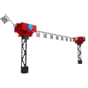

# AG - Rebuild Finish Line - quest/objective source LOT 6097

<!-- media:start (generated by scripts/build_media.py) -->
{ .lu-icon .lu-on-light width="128" loading="lazy" }
<!-- media:end -->

[Quest database](../README.md) | [Methodology](../Methodology.md)

## Candidate placements / spawner waypoints

Coordinates are static map XYZ, not confirmed live NPC positions. Multiple scene objects and waypoints may refer to a shared spawn mechanism; counts are not population estimates. Feature gates and disabled auto-spawning are retained, and client-only objects are excluded.

| Zone | X | Y | Z | Origin | Conditions |
| --- | --- | --- | --- | --- | --- |
| [Avant Gardens (1100)](../locations/zone-1100.md) | 310.4 | 469.673 | 299.2 | Scene nd&#95;avant&#95;gardens&#95;38&#95;monument&#95;race.lvl (Monument&#95;Race), layer 0; LOT 176 spawner | Scene precondition: 256;19; Automatic spawning disabled; trigger/script may be required |
