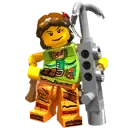

# Renee Tombcrusher - Venture League Explorer - quest/objective source LOT 6236

<!-- media:start (generated by scripts/build_media.py) -->
{ .lu-icon .lu-on-dark width="128" loading="lazy" }
<!-- media:end -->

[Quest database](../README.md) | [Methodology](../Methodology.md)

Associated quest/achievement definitions: [Find Renee Tombcrusher &#91;380&#93;](../380.md); [Lily-Livered &#91;382&#93;](../382.md); [Just Stunning &#91;541&#93;](../541.md); [Name Dropper &#91;772&#93;](../772.md).

## Candidate placements / spawner waypoints

Coordinates are static map XYZ, not confirmed live NPC positions. Multiple scene objects and waypoints may refer to a shared spawn mechanism; counts are not population estimates. Feature gates and disabled auto-spawning are retained, and client-only objects are excluded.

| Zone | X | Y | Z | Origin | Conditions |
| --- | --- | --- | --- | --- | --- |
| [Gnarled Forest Deep Dive Map (375)](../locations/zone-375.md) | -429.521 | 316.686 | 61.748 | Scene nd&#95;gnarled&#95;forest&#95;15&#95;battle.lvl (Battle), layer 0; LOT 176 spawner | Automatic spawning disabled; trigger/script may be required |
| [Gnarled Forest (1300)](../locations/zone-1300.md) | -429.521 | 316.686 | 61.748 | Scene nd&#95;gnarled&#95;forest&#95;15&#95;battle.lvl (Battle), layer 0; LOT 176 spawner | Automatic spawning disabled; trigger/script may be required |
