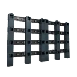

# GF - QB Non-Smash Wall - quest/objective source LOT 6878

<!-- media:start (generated by scripts/build_media.py) -->
{ .lu-icon width="128" loading="lazy" }
<!-- media:end -->

[Quest database](../README.md) | [Methodology](../Methodology.md)

## Candidate placements / spawner waypoints

Coordinates are static map XYZ, not confirmed live NPC positions. Multiple scene objects and waypoints may refer to a shared spawn mechanism; counts are not population estimates. Feature gates and disabled auto-spawning are retained, and client-only objects are excluded.

| Zone | X | Y | Z | Origin | Conditions |
| --- | --- | --- | --- | --- | --- |
| [Crux Prime (1800)](../locations/zone-1800.md) | 771.225 | 61.123 | 62.819 | Scene nd&#95;aura&#95;mar&#95;27&#95;teethb.lvl (TeethB), layer 0; LOT 176 spawner | Feature gate: auramarruins; Automatic spawning disabled; trigger/script may be required |
| [Crux Prime (1800)](../locations/zone-1800.md) | 796.418 | 58.137 | 71.104 | Scene nd&#95;aura&#95;mar&#95;27&#95;teethb.lvl (TeethB), layer 0; LOT 176 spawner | Feature gate: auramarruins; Automatic spawning disabled; trigger/script may be required |
| [Crux Prime (1800)](../locations/zone-1800.md) | 822.574 | 55.451 | 80.077 | Scene nd&#95;aura&#95;mar&#95;27&#95;teethb.lvl (TeethB), layer 0; LOT 176 spawner | Feature gate: auramarruins; Automatic spawning disabled; trigger/script may be required |
| [Crux Prime (1800)](../locations/zone-1800.md) | 845.834 | 52.965 | 88.839 | Scene nd&#95;aura&#95;mar&#95;27&#95;teethb.lvl (TeethB), layer 0; LOT 176 spawner | Feature gate: auramarruins; Automatic spawning disabled; trigger/script may be required |
| [Crux Prime (1800)](../locations/zone-1800.md) | 781.228 | 61.465 | 41.694 | Scene nd&#95;aura&#95;mar&#95;27&#95;teethb.lvl (TeethB), layer 0; LOT 176 spawner | Feature gate: auramarruins; Automatic spawning disabled; trigger/script may be required |
| [Crux Prime (1800)](../locations/zone-1800.md) | 804.083 | 58.151 | 51.462 | Scene nd&#95;aura&#95;mar&#95;27&#95;teethb.lvl (TeethB), layer 0; LOT 176 spawner | Feature gate: auramarruins; Automatic spawning disabled; trigger/script may be required |
| [Crux Prime (1800)](../locations/zone-1800.md) | 829.823 | 55.337 | 61.568 | Scene nd&#95;aura&#95;mar&#95;27&#95;teethb.lvl (TeethB), layer 0; LOT 176 spawner | Feature gate: auramarruins; Automatic spawning disabled; trigger/script may be required |
| [Crux Prime (1800)](../locations/zone-1800.md) | 854.63 | 51.922 | 70.944 | Scene nd&#95;aura&#95;mar&#95;27&#95;teethb.lvl (TeethB), layer 0; LOT 176 spawner | Feature gate: auramarruins; Automatic spawning disabled; trigger/script may be required |
