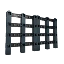

# GF - Smash Wall - quest/objective source LOT 6946

<!-- media:start (generated by scripts/build_media.py) -->
{ .lu-icon .lu-on-light width="128" loading="lazy" }
<!-- media:end -->

[Quest database](../README.md) | [Methodology](../Methodology.md)

## Candidate placements / spawner waypoints

Coordinates are static map XYZ, not confirmed live NPC positions. Multiple scene objects and waypoints may refer to a shared spawn mechanism; counts are not population estimates. Feature gates and disabled auto-spawning are retained, and client-only objects are excluded.

| Zone | X | Y | Z | Origin | Conditions |
| --- | --- | --- | --- | --- | --- |
| [Gnarled Forest Deep Dive Map (375)](../locations/zone-375.md) | 173.539 | 286.009 | 143.77 | Spawner path: JailQBWall | Automatic spawning disabled; trigger/script may be required |
| [Gnarled Forest (1300)](../locations/zone-1300.md) | 173.539 | 286.009 | 143.77 | Spawner path: JailQBWall | Automatic spawning disabled; trigger/script may be required |
