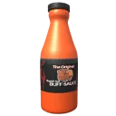

# Tough Buff Sauce - quest/objective source LOT 8376

<!-- media:start (generated by scripts/build_media.py) -->
{ .lu-icon .lu-on-dark width="128" loading="lazy" }
<!-- media:end -->

[Quest database](../README.md) | [Methodology](../Methodology.md)

Item acquisition: [Tough Buff Sauce (LOT 8376)](../../items/8376.md).

## Candidate placements / spawner waypoints

Coordinates are static map XYZ, not confirmed live NPC positions. Multiple scene objects and waypoints may refer to a shared spawn mechanism; counts are not population estimates. Feature gates and disabled auto-spawning are retained, and client-only objects are excluded.

No placement was found in successfully parsed maps with an exact ZoneTable asset-path match. Scripted, missing, or unused content remains possible.
