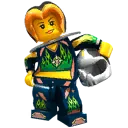

# Velocity Lane - Racing Trainer - quest/objective source LOT 9821

<!-- media:start (generated by scripts/build_media.py) -->
{ .lu-icon width="128" loading="lazy" }
<!-- media:end -->

[Quest database](../README.md) | [Methodology](../Methodology.md)

Associated quest/achievement definitions: [Get Ready to Race! &#91;622&#93;](../622.md); [Build Your Ride! &#91;623&#93;](../623.md); [Enter a Race &#91;624&#93;](../624.md); [Speed Boost! &#91;625&#93;](../625.md); [Vertigo Loop Top 3 &#91;626&#93;](../626.md); [Max Velocity &#91;627&#93;](../627.md); [Vertigo Loop Victory &#91;628&#93;](../628.md); [Find Swifty McGurk &#91;629&#93;](../629.md); [That Velocity Lass &#91;637&#93;](../637.md); [Race Series 1 &#91;668&#93;](../668.md).

## Candidate placements / spawner waypoints

Coordinates are static map XYZ, not confirmed live NPC positions. Multiple scene objects and waypoints may refer to a shared spawn mechanism; counts are not population estimates. Feature gates and disabled auto-spawning are retained, and client-only objects are excluded.

| Zone | X | Y | Z | Origin | Conditions |
| --- | --- | --- | --- | --- | --- |
| [Nimbus Station (1200)](../locations/zone-1200.md) | 264.485 | 288.981 | 170.083 | Scene nd&#95;nimbus&#95;station&#95;15&#95;race&#95;place.lvl (Race Place), layer 0; LOT 176 spawner | Automatic spawning disabled; trigger/script may be required |
