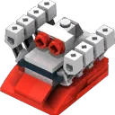
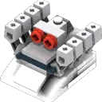
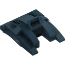
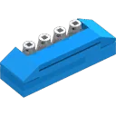
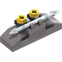
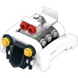
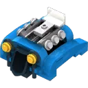
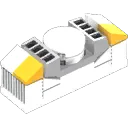
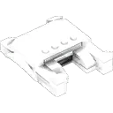
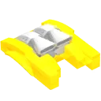

# Space Blizzard

[Racing index](../README.md) | [Methodology](../Methodology.md) | [Race quests](../Racing%20Quests%20and%20Achievements.md)

## What and where

Activity 60 and its activity rewards are present in the database, and the track LVL/LUZ assets are present locally. The track asset has embedded world ID 1261 but no exact ZoneTable asset-path match, so its availability is legacy/seasonal evidence rather than a current world mapping.

**Name and zone status:** the client calls this activity “Space Blizzard Racetrack” (`Activities_60_ActivityName`; the race UI title `UI_RACE_NS_W_TITLE` uses the same name and the help text says “A Space Blizzard has frozen the Vertigo Loop Racetrack!”). Instance 1261 itself has **no ZoneTable row** and no `ZoneTable_1261_DisplayDescription` string. The only related ZoneTable row is zone **556 “Winter Racetrack”** (locStatus 0, no client display name), whose path `01_Live_Maps/Nimbus_Station/Winter_Racetrack/nd_nimbus_station_winter-racetrack.luz` is not present locally; the local track asset is `client/res/maps/seasonal_live maps/december/ns_winter_racetrack/nd_nimbus_station_winter-racetrack.luz` (embedded world 1261). Mission tasks that list world 1261 are shown as “Space Blizzard Racetrack (1261)”. DarkflameServer finds a world's map file through its ZoneTable row (`Zone.cpp`), so this race cannot load unless the server adds a row for 1261.

- **World / activity instance:** Frostburgh (seasonal) (world 1260); instance 1261
- **Server activity:** 60; activity table location 1261
- **Local ZoneTable asset:** no ZoneTable row for 1261 (closest: zone 556 “Winter Racetrack”, locStatus 0, different asset path)
- **Map parse:** embedded world 1261; 1 scene(s); 133 spawner waypoint(s)
- **Scene names:** `Global Scene`
- **Historical track name:** Space Blizzard Racetrack (see revision-pinned [community source](../Community%20Sources.md#space-blizzard))
- **Client name (locale.xml):** Space Blizzard Racetrack (`Activities_60_ActivityName`; there is no ZoneTable row or `ZoneTable_1261_DisplayDescription` string for instance 1261)

### Entry point and coordinates

| Object LOT / name | Zone asset | Scene / level | XYZ (map units) | Evidence |
| --- | --- | --- | --- | --- |
| 11418 — WT - Race Activator | 1260 (asset-only world ID) | Global Scene — ns_property_large_winter.lvl | -290.04, 535.41, 147.37 | `client/res/maps/seasonal_live maps/december/winter_celebrity_property/ns_property_large_winter.lvl`; LDF activityID 60; transferZoneID 1261; server script L_GF_RACE_INSTANCER.lua |

Coordinates are static LVL object origins in the authored map asset, not a live NPC/player position, path trigger, or guarantee that the activity is enabled. Where local component registration does not prove which object launches this track, it is not labeled as an entrance.

## How the race works

The local per-track server scripts configure this activity as a three-lap car race for individual racers: 2–6 teams/players, one player per team, a 60-second wait period, and a 3-second start delay. The configured vehicle is LOT 7703 (a static test-named “Racing Vehicle Min Balanced” vehicle template); this is not a player-car LOT recommendation. The race uses the `MainPath` route. Exact current deployment, player count, timing, client UI, or availability can differ.

Configured optional entry cost: [Green Imaginite (LOT 3039)](../../items/3039.md) × 1. This is the Activities row value; it is not a guaranteed deduction on every server/client flow.

1. Reach the track through its world activity/entry route, if available.
2. Bring/use a player-built race car and enter the race instance.
3. Complete the three laps, crossing track checkpoints and avoiding course hazards. The local track script sets race/activity state; track-specific item names and hazards are partly documented only by historical sources.
4. Finish to produce a placement/rating. The rating selects the stored activity-reward tier below; it does not itself specify the probability of an individual item.

### Track-specific route evidence

The inspected track is a winter-themed version of the Nimbus track. Reused model names and shared reward matrices do not establish that it was independently available outside Frostburgh.

The public source describes an icy seasonal reuse of Vertigo Loop with snowmen replacing the usual cones and blizzard zones that slow vehicles and interfere with imagination boosts.

Frostburgh is not asserted to be live or reachable in the checked server snapshot.

## Race results and rewards

The local `ActivityRewards` table has 20 rows for activity 60, referencing 11 distinct loot matrices. The server chooses the highest `activityRating` not greater than the result rating. Each selected row provides a loot-matrix index and currency index. A matrix roll is not a “drop rate” for every item: each row triggers by its own percentage, the number of draws varies, rarity tables weight eligible loot rows, and MissionDrop/player/team/faction conditions may filter or transform results.

| Activity rating | Stored tier / place | Loot matrix | Currency index | Challenge rating |
| --- | --- | --- | --- | --- |
| 21 | FB Racetrack 1st Place - 2 players | 651 | 78 | 1 |
| 22 | FB Racetrack 2nd Place - 2 players | 652 | 79 | 1 |
| 31 | FB Racetrack 1st Place - 3 players | 648 | 75 | 1 |
| 32 | FB Racetrack 2nd Place - 3 players | 649 | 76 | 1 |
| 33 | FB Racetrack 3rd Place - 3 players | 650 | 77 | 1 |
| 41 | FB Racetrack 1st Place - 4 players | 642 | 69 | 1 |
| 42 | FB Racetrack 2nd Place - 4 players | 643 | 70 | 1 |
| 43 | FB Racetrack 3rd Place - 4 players | 644 | 71 | 1 |
| 44 | FB Racetrack 4th Place - 4 players | 645 | 72 | 1 |
| 51 | FB Racetrack 1st Place - 5 players | 642 | 69 | 1 |
| 52 | FB Racetrack 2nd Place - 5 players | 643 | 70 | 1 |
| 53 | FB Racetrack 3rd Place - 5 players | 644 | 71 | 1 |
| 54 | FB Racetrack 4th Place - 5 players | 645 | 72 | 1 |
| 55 | FB Racetrack 5th Place - 5 players | 646 | 73 | 1 |
| 61 | FB Racetrack 1st Place - 6 players | 642 | 69 | 1 |
| 62 | FB Racetrack 2nd Place - 6 players | 643 | 70 | 1 |
| 63 | FB Racetrack 3rd Place - 6 players | 644 | 71 | 1 |
| 64 | FB Racetrack 4th Place - 6 players | 645 | 72 | 1 |
| 65 | FB Racetrack 5th Place - 6 players | 646 | 73 | 1 |
| 66 | FB Racetrack 6th Place - 6 players | 647 | 74 | 1 |

### Possible item outcomes from those matrices

| Loot matrix | Distinct candidate LOTs | Candidate items and modeled chance |
| --- | --- | --- |
| 642 | 11 | Faction Token Proxy LOT 13763 — modeled 100.0000% (server replacement/discard is conditional; not a direct player item) { .lu-ti width="24" loading="lazy" } [Chase Cutter Engine Panel 2 (LOT 9336)](../../items/9336.md) — modeled 10% per matrix invocation { .lu-ti width="24" loading="lazy" } [Chase Cutter Engine Panel 2 (LOT 9339)](../../items/9339.md) — modeled 10% per matrix invocation { .lu-ti width="24" loading="lazy" } [Chase Cutter Rear Panel 3 (LOT 9362)](../../items/9362.md) — modeled 10% per matrix invocation { .lu-ti width="24" loading="lazy" } [Chase Cutter Rear Bumper 2 (LOT 9371)](../../items/9371.md) — modeled 10% per matrix invocation { .lu-ti width="24" loading="lazy" } [Bolt Ox Front Bumper 2 (LOT 9376)](../../items/9376.md) — modeled 10% per matrix invocation { .lu-ti width="24" loading="lazy" } [Bolt Ox Engine Panel 1 (LOT 9381)](../../items/9381.md) — modeled 10% per matrix invocation { .lu-ti width="24" loading="lazy" } [Bolt Ox Engine Panel 2 (LOT 9384)](../../items/9384.md) — modeled 10% per matrix invocation { .lu-ti width="24" loading="lazy" } [Paragon Warp Front Bumper 1 (LOT 9404)](../../items/9404.md) — modeled 10% per matrix invocation { .lu-ti width="24" loading="lazy" } [Paragon Warp Rear Panel 1 (LOT 9424)](../../items/9424.md) — modeled 10% per matrix invocation { .lu-ti width="24" loading="lazy" } [Paragon Warp Rear Panel 2 (LOT 9426)](../../items/9426.md) — modeled 10% per matrix invocation |
| 643 | 1 | Faction Token Proxy LOT 13763 — modeled 100.0000% (server replacement/discard is conditional; not a direct player item) |
| 644 | 1 | Faction Token Proxy LOT 13763 — modeled 100.0000% (server replacement/discard is conditional; not a direct player item) |
| 645 | 1 | Faction Token Proxy LOT 13763 — modeled 100.0000% (server replacement/discard is conditional; not a direct player item) |
| 646 | 1 | Faction Token Proxy LOT 13763 — modeled 100.0000% (server replacement/discard is conditional; not a direct player item) |
| 647 | 1 | Faction Token Proxy LOT 13763 — modeled 100.0000% (server replacement/discard is conditional; not a direct player item) |
| 648 | 11 | Faction Token Proxy LOT 13763 — modeled 100.0000% (server replacement/discard is conditional; not a direct player item) { .lu-ti width="24" loading="lazy" } [Chase Cutter Engine Panel 2 (LOT 9336)](../../items/9336.md) — modeled 10% per matrix invocation { .lu-ti width="24" loading="lazy" } [Chase Cutter Engine Panel 2 (LOT 9339)](../../items/9339.md) — modeled 10% per matrix invocation { .lu-ti width="24" loading="lazy" } [Chase Cutter Rear Panel 3 (LOT 9362)](../../items/9362.md) — modeled 10% per matrix invocation { .lu-ti width="24" loading="lazy" } [Chase Cutter Rear Bumper 2 (LOT 9371)](../../items/9371.md) — modeled 10% per matrix invocation { .lu-ti width="24" loading="lazy" } [Bolt Ox Front Bumper 2 (LOT 9376)](../../items/9376.md) — modeled 10% per matrix invocation { .lu-ti width="24" loading="lazy" } [Bolt Ox Engine Panel 1 (LOT 9381)](../../items/9381.md) — modeled 10% per matrix invocation { .lu-ti width="24" loading="lazy" } [Bolt Ox Engine Panel 2 (LOT 9384)](../../items/9384.md) — modeled 10% per matrix invocation { .lu-ti width="24" loading="lazy" } [Paragon Warp Front Bumper 1 (LOT 9404)](../../items/9404.md) — modeled 10% per matrix invocation { .lu-ti width="24" loading="lazy" } [Paragon Warp Rear Panel 1 (LOT 9424)](../../items/9424.md) — modeled 10% per matrix invocation { .lu-ti width="24" loading="lazy" } [Paragon Warp Rear Panel 2 (LOT 9426)](../../items/9426.md) — modeled 10% per matrix invocation |
| 649 | 1 | Faction Token Proxy LOT 13763 — modeled 100.0000% (server replacement/discard is conditional; not a direct player item) |
| 650 | 1 | Faction Token Proxy LOT 13763 — modeled 100.0000% (server replacement/discard is conditional; not a direct player item) |
| 651 | 1 | Faction Token Proxy LOT 13763 — modeled 100.0000% (server replacement/discard is conditional; not a direct player item) |
| 652 | 1 | Faction Token Proxy LOT 13763 — modeled 100.0000% (server replacement/discard is conditional; not a direct player item) |

Per-item percentages above are **modeled chance of at least one LOT per matrix invocation**, before player/mission eligibility filters and proxy-token conversion, using the checked source's LootMatrix/RarityTable/LootTable selection rules. Repeated LootTable rows are retained in weighting. These are not unconditional per-race or per-player probabilities and do not account for team assignment, mission filters, or live-server overrides. Reward rows which share a matrix share its candidate pool; the rank/rating controls which matrix/currency pair is selected.

**Currency indexes are kept as indexes, not converted to a coin range here.** See the exact row in [ActivityRewards.csv](../../../db/ActivityRewards.csv) and related [CurrencyTable.csv](../../../db/CurrencyTable.csv).

## Related quests and achievements

| Existing quest/achievement page | Racing-linked objective(s) |
| --- | --- |
| [Quest 625](../../quests/625.md) — Speed Boost! | UID 941: Collect racing Imagination pickups until the counter reaches 9 on allowed tracks: Vertigo Loop Racetrack / Keelhaul Canyon Racetrack / Dragonmaw Chasm Racetrack / Space Blizzard Racetrack (1261). |
| [Achievement 648](../../quests/648.md) — Low Deductible 1 | UID 964: Finish 10 matching race(s) without being smashed: Vertigo Loop Racetrack / Keelhaul Canyon Racetrack / Dragonmaw Chasm Racetrack / Space Blizzard Racetrack (1261). |
| [Achievement 649](../../quests/649.md) — Low Deductible 2 | UID 965: Finish 25 matching race(s) without being smashed: Vertigo Loop Racetrack / Keelhaul Canyon Racetrack / Dragonmaw Chasm Racetrack / Space Blizzard Racetrack (1261). |
| [Achievement 650](../../quests/650.md) — Low Deductible 3 | UID 966: Finish 50 matching race(s) without being smashed: Vertigo Loop Racetrack / Keelhaul Canyon Racetrack / Dragonmaw Chasm Racetrack / Space Blizzard Racetrack (1261). |
| [Achievement 651](../../quests/651.md) — Street Sweeper 1 | UID 967: Smash racing smashables until the counter reaches 100 on allowed tracks: Vertigo Loop Racetrack / Keelhaul Canyon Racetrack / Dragonmaw Chasm Racetrack / Space Blizzard Racetrack (1261). |
| [Achievement 652](../../quests/652.md) — Street Sweeper 2 | UID 968: Smash racing smashables until the counter reaches 250 on allowed tracks: Vertigo Loop Racetrack / Keelhaul Canyon Racetrack / Dragonmaw Chasm Racetrack / Space Blizzard Racetrack (1261). |
| [Achievement 653](../../quests/653.md) — Street Sweeper 3 | UID 969: Smash racing smashables until the counter reaches 500 on allowed tracks: Vertigo Loop Racetrack / Keelhaul Canyon Racetrack / Dragonmaw Chasm Racetrack / Space Blizzard Racetrack (1261). |
| [Achievement 654](../../quests/654.md) — Drive-Thru Dreamer 1 | UID 970: Collect racing Imagination pickups until the counter reaches 100 on allowed tracks: Vertigo Loop Racetrack / Keelhaul Canyon Racetrack / Dragonmaw Chasm Racetrack / Space Blizzard Racetrack (1261). |
| [Achievement 655](../../quests/655.md) — Drive-Thru Dreamer 2 | UID 971: Collect racing Imagination pickups until the counter reaches 500 on allowed tracks: Vertigo Loop Racetrack / Keelhaul Canyon Racetrack / Dragonmaw Chasm Racetrack / Space Blizzard Racetrack (1261). |
| [Achievement 656](../../quests/656.md) — Drive-Thru Dreamer 3 | UID 972: Collect racing Imagination pickups until the counter reaches 1000 on allowed tracks: Vertigo Loop Racetrack / Keelhaul Canyon Racetrack / Dragonmaw Chasm Racetrack / Space Blizzard Racetrack (1261). |
| [Achievement 657](../../quests/657.md) — Racing Fanatic 1 | UID 973: Finish/participate in 25 credited race completion(s) on allowed tracks: Vertigo Loop Racetrack / Keelhaul Canyon Racetrack / Dragonmaw Chasm Racetrack / Space Blizzard Racetrack (1261). |
| [Achievement 658](../../quests/658.md) — Racing Fanatic 2 | UID 974: Finish/participate in 25 credited race completion(s) on allowed tracks: Vertigo Loop Racetrack / Keelhaul Canyon Racetrack / Dragonmaw Chasm Racetrack / Space Blizzard Racetrack (1261). |
| [Achievement 659](../../quests/659.md) — Racing Fanatic 3 | UID 975: Finish/participate in 50 credited race completion(s) on allowed tracks: Vertigo Loop Racetrack / Keelhaul Canyon Racetrack / Dragonmaw Chasm Racetrack / Space Blizzard Racetrack (1261). |
| [Achievement 661](../../quests/661.md) — Five-Time Champion | UID 977: Win 5 credited race(s) in allowed worlds: Vertigo Loop Racetrack / Keelhaul Canyon Racetrack / Dragonmaw Chasm Racetrack / Space Blizzard Racetrack (1261). |
| [Achievement 662](../../quests/662.md) — Ten-Time Champion | UID 978: Win 10 credited race(s) in allowed worlds: Vertigo Loop Racetrack / Keelhaul Canyon Racetrack / Dragonmaw Chasm Racetrack / Space Blizzard Racetrack (1261). |
| [Achievement 663](../../quests/663.md) — Twenty-Time Champion | UID 979: Win 20 credited race(s) in allowed worlds: Vertigo Loop Racetrack / Keelhaul Canyon Racetrack / Dragonmaw Chasm Racetrack / Space Blizzard Racetrack (1261). |
| [Achievement 667](../../quests/667.md) — Try, Try Again | UID 983: Finish last in 10 credited race(s) on allowed tracks: Vertigo Loop Racetrack / Keelhaul Canyon Racetrack / Dragonmaw Chasm Racetrack / Space Blizzard Racetrack (1261). |
| [Achievement 1168](../../quests/1168.md) — Space Blizzard Super Champ | UID 1623: Win 10 credited race(s) in allowed worlds: Space Blizzard Racetrack (1261). |
| [Quest 1408](../../quests/1408.md) — Drive Five | UID 1940: Finish/participate in 5 credited race completion(s) on allowed tracks: Vertigo Loop Racetrack / Keelhaul Canyon Racetrack / Dragonmaw Chasm Racetrack / Space Blizzard Racetrack (1261). |
| [Quest 1506](../../quests/1506.md) — Drive Five | UID 2078: Finish/participate in 5 credited race completion(s) on allowed tracks: Vertigo Loop Racetrack / Keelhaul Canyon Racetrack / Dragonmaw Chasm Racetrack / Space Blizzard Racetrack (1261). |
| [Quest 1543](../../quests/1543.md) — Drive Five | UID 2140: Finish/participate in 5 credited race completion(s) on allowed tracks: Vertigo Loop Racetrack / Keelhaul Canyon Racetrack / Dragonmaw Chasm Racetrack / Space Blizzard Racetrack (1261). |
| [Quest 1580](../../quests/1580.md) — Drive Five | UID 2202: Finish/participate in 5 credited race completion(s) on allowed tracks: Vertigo Loop Racetrack / Keelhaul Canyon Racetrack / Dragonmaw Chasm Racetrack / Space Blizzard Racetrack (1261). |
| [Achievement 1772](../../quests/1772.md) — Low Deductible | UID 2533: Finish 100 matching race(s) without being smashed: Vertigo Loop Racetrack / Keelhaul Canyon Racetrack / Dragonmaw Chasm Racetrack / Space Blizzard Racetrack (1261). |
| [Achievement 1773](../../quests/1773.md) — Racing Fanatic | UID 2534: Finish/participate in 100 credited race completion(s) on allowed tracks: Vertigo Loop Racetrack / Keelhaul Canyon Racetrack / Dragonmaw Chasm Racetrack / Space Blizzard Racetrack (1261). |
| [Achievement 1774](../../quests/1774.md) — Fifty-Time Champion | UID 2535: Win 50 credited race(s) in allowed worlds: Vertigo Loop Racetrack / Keelhaul Canyon Racetrack / Dragonmaw Chasm Racetrack / Space Blizzard Racetrack (1261). |
| [Achievement 1775](../../quests/1775.md) — Street Sweeper | UID 2536: Smash racing smashables until the counter reaches 1000 on allowed tracks: Vertigo Loop Racetrack / Keelhaul Canyon Racetrack / Dragonmaw Chasm Racetrack / Space Blizzard Racetrack (1261). |
| [Achievement 1776](../../quests/1776.md) — Drive-Thru Dreamer | UID 2537: Collect racing Imagination pickups until the counter reaches 1500 on allowed tracks: Vertigo Loop Racetrack / Keelhaul Canyon Racetrack / Dragonmaw Chasm Racetrack / Space Blizzard Racetrack (1261). |

Rewards for missions/achievements are documented on their existing quest pages; they are not substituted for the activity-result matrix above.

## Evidence and limits

- Local static tables: [Activities](../../../db/Activities.csv), [ActivityRewards](../../../db/ActivityRewards.csv), [ZoneTable](../../../db/ZoneTable.csv), [Objects](../../../db/Objects.csv), [ComponentsRegistry](../../../db/ComponentsRegistry.csv), [LootMatrix](../../../db/LootMatrix.csv), [LootTable](../../../db/LootTable.csv), and [RarityTable](../../../db/RarityTable.csv).
- Local server script: [NsWinterRaceServer.cpp](https://github.com/DarkflameUniverse/DarkflameServer/blob/8b7d1b946b5e7df18f2c82ccabcb2634aefc11f4/dScripts/ai/RACING/TRACK_NS_WINTER/NsWinterRaceServer.cpp); activity-result selection: [Loot.cpp](https://github.com/DarkflameUniverse/DarkflameServer/blob/8b7d1b946b5e7df18f2c82ccabcb2634aefc11f4/dGame/dUtilities/Loot.cpp).
- Historical route/name/hazards are attributed in [Community Sources](../Community%20Sources.md#space-blizzard); they are not treated as proof of this local revision's live state.
- No complete live server configuration, dialogue, client activation sequence, or authenticated deployment state is supplied.
