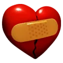

# Healing Pulse

<!-- media:start (generated by scripts/build_media.py) -->
{ .lu-icon .lu-on-light width="128" loading="lazy" }
<!-- media:end -->

[Player skills](./README.md) | [Methodology](./Methodology.md)

**Skill ID:** 1006

## Description

Sends out a pulse of energy that restores 10 Life Points to nearby characters.

Name and tooltip: official English client text (`locale.xml`, `en_US`).

## Recorded settings

- **Imagination cost (client data):** 6
- **Cooldown value (client data):** 10

These are stored values, not measured live behavior; set bonuses and equipment casts can follow different server paths.

## Equipment associations

These items have an ObjectSkills cast-on-type 0 association and a supported equipment slot. Follow each item link for source and requirement evidence.

- [Padded Toque of Healing (LOT 12601)](../items/12601.md) — slot `hair`
- [Medic Shield (LOT 12742)](../items/12742.md) — slot `special_l`

## Equipment-set associations

No qualifying set association was found.

A listed association does not establish that the skill, item, or set is obtainable or fully implemented in a particular deployment.
