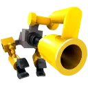

# Summon Make-Shift Buddy 3

<!-- media:start (generated by scripts/build_media.py) -->
{ width="48" loading="lazy" }
<!-- media:end -->

[Player skills](./README.md) | [Methodology](./Methodology.md)

**Skill ID:** 1057

## Description

Damage: 2. Creates a faster firing Invention that assists you in battle.

Name and tooltip: official English client text (`locale.xml`, `en_US`).

**Historical community name:** Invention 3. [Faction Gear, revision 163921](https://legouniverse.fandom.com/api.php?action=query&prop=revisions&revids=163921&rvprop=ids%7Ccontent&rvslots=main&formatversion=2&format=json) associates this name with Rank 3 Inventor Goggles; the local data associates [Inventor Goggles 3 (LOT 7456)](../items/7456.md) with skill 1057. This indirect equipment match differs from the official client name, which takes precedence.

## Recorded settings

- **Imagination cost (client data):** 8
- **Cooldown value (client data):** 45

These are stored values, not measured live behavior; set bonuses and equipment casts can follow different server paths.

## Equipment associations

These items have an ObjectSkills cast-on-type 0 association and a supported equipment slot. Follow each item link for source and requirement evidence.

- [Inventor Goggles 3 (LOT 7456)](../items/7456.md) — slot `hair`

## Equipment-set associations

No qualifying set association was found.

A listed association does not establish that the skill, item, or set is obtainable or fully implemented in a particular deployment.
