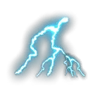

# Dark Lightning 1

<!-- media:start (generated by scripts/build_media.py) -->
{ width="48" loading="lazy" }
<!-- media:end -->

[Player skills](./README.md) | [Methodology](./Methodology.md)

**Skill ID:** 1075

## Description

Damage: 5. Strikes enemies with lightning, doing 5 damage.

Name and tooltip: official English client text (`locale.xml`, `en_US`).

**Historical community name:** Shinobi Lightning 1. [Shinobi, revision 164260](https://legouniverse.fandom.com/api.php?action=query&prop=revisions&revids=164260&rvprop=ids%7Ccontent&rvslots=main&formatversion=2&format=json) associates this name with Shinobi Hood 1; the local data associates [Shinobi Hood 1 (LOT 7451)](../items/7451.md) with skill 1075. This indirect equipment match differs from the official client name, which takes precedence.

## Recorded settings

- **Imagination cost (client data):** 6
- **Cooldown value (client data):** 10

These are stored values, not measured live behavior; set bonuses and equipment casts can follow different server paths.

## Equipment associations

These items have an ObjectSkills cast-on-type 0 association and a supported equipment slot. Follow each item link for source and requirement evidence.

- [Shinobi Hood 1 (LOT 7451)](../items/7451.md) — slot `hair`

## Equipment-set associations

No qualifying set association was found.

A listed association does not establish that the skill, item, or set is obtainable or fully implemented in a particular deployment.
