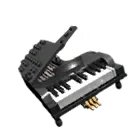

# Radio For Assistance

<!-- media:start (generated by scripts/build_media.py) -->
{ width="48" loading="lazy" }
<!-- media:end -->

[Player skills](./README.md) | [Methodology](./Methodology.md)

**Skill ID:** 1256

## Description

Damage: 9. Drops an exploding piano that does 9 damage to an enemy.

Name and tooltip: official English client text (`locale.xml`, `en_US`).

## Recorded settings

- **Imagination cost (client data):** 5
- **Cooldown value (client data):** 9

These are stored values, not measured live behavior; set bonuses and equipment casts can follow different server paths.

## Equipment associations

These items have an ObjectSkills cast-on-type 0 association and a supported equipment slot. Follow each item link for source and requirement evidence.

- [Foreman Radio (LOT 13580)](../items/13580.md) — slot `special_l`

## Equipment-set associations

No qualifying set association was found.

A listed association does not establish that the skill, item, or set is obtainable or fully implemented in a particular deployment.
