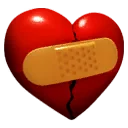

# Ninja Healing

<!-- media:start (generated by scripts/build_media.py) -->
{ .lu-icon .lu-on-light width="128" loading="lazy" }
<!-- media:end -->

[Player skills](./README.md) | [Methodology](./Methodology.md)

**Skill ID:** 1461

## Description

Restores 3 Life.

Name and tooltip: official English client text (`locale.xml`, `en_US`).

## Recorded settings

- **Imagination cost (client data):** 2
- **Cooldown value (client data):** 10

These are stored values, not measured live behavior; set bonuses and equipment casts can follow different server paths.

## Equipment associations

These items have an ObjectSkills cast-on-type 0 association and a supported equipment slot. Follow each item link for source and requirement evidence.

- [Athlete's Shade (LOT 15918)](../items/15918.md) — slot `hair`
- [Apothecary's Hood (LOT 15935)](../items/15935.md) — slot `hair`
- [Kiro Swordsman's Hood (LOT 15947)](../items/15947.md) — slot `hair`
- [Spearman's Healing Hood (LOT 15959)](../items/15959.md) — slot `hair`

## Equipment-set associations

No qualifying set association was found.

A listed association does not establish that the skill, item, or set is obtainable or fully implemented in a particular deployment.
