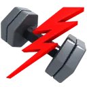

# Juggernaut 1

<!-- media:start (generated by scripts/build_media.py) -->
{ .lu-icon .lu-on-light width="128" loading="lazy" }
<!-- media:end -->

[Player skills](./README.md) | [Methodology](./Methodology.md)

**Skill ID:** 431

## Description

Restores 1 Armor every time you smash an enemy.

Name and tooltip: official English client text (`locale.xml`, `en_US`).

## Recorded settings

- **Imagination cost (client data):** 0
- **Cooldown value (client data):** -1

These are stored values, not measured live behavior; set bonuses and equipment casts can follow different server paths.

## Equipment associations

No qualifying direct equipment association was found.

## Equipment-set associations

- **Set 8, 5 equipped pieces:** [Knight Helm 2 (LOT 7359)](../items/7359.md), [Knight Breastplate 2 (LOT 7368)](../items/7368.md), [Knight Leggings 2 (LOT 7380)](../items/7380.md), [Knight Greatsword 2 (LOT 7392)](../items/7392.md), [Knight Shield 2 (LOT 7403)](../items/7403.md), [Knight Shoulderpads 2 (LOT 8456)](../items/8456.md)
- **Set 11, 5 equipped pieces:** [Space Ranger Helmet 2 (LOT 7443)](../items/7443.md), [Space Ranger Armor 2 (LOT 7467)](../items/7467.md), [Space Ranger Pants 2 (LOT 7491)](../items/7491.md), [Space Ranger Zipgun 2 (LOT 7515)](../items/7515.md), [Space Ranger Launcher 2 (LOT 7544)](../items/7544.md), [Space Ranger Pack 2 (LOT 8457)](../items/8457.md)
- **Set 14, 5 equipped pieces:** [Samurai Helm 2 (LOT 7446)](../items/7446.md), [Samurai Breastplate 2 (LOT 7470)](../items/7470.md), [Samurai Leggings 2 (LOT 7494)](../items/7494.md), [Samurai Katana 2 (LOT 7518)](../items/7518.md), [Samurai Bow 2 (LOT 7546)](../items/7546.md), [Samurai Shoulderpads 2 (LOT 8458)](../items/8458.md)

A listed association does not establish that the skill, item, or set is obtainable or fully implemented in a particular deployment.
