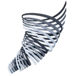

# Ronin Rush

<!-- media:start (generated by scripts/build_media.py) -->
{ .lu-icon .lu-on-dark width="128" loading="lazy" }
<!-- media:end -->

[Player skills](./README.md) | [Methodology](./Methodology.md)

**Skill ID:** 550

## Description

Damage: 12. Makes you perform a flying kick, doing 12 damage and knocking down enemies.

Name and tooltip: official English client text (`locale.xml`, `en_US`).

## Recorded settings

- **Imagination cost (client data):** 9
- **Cooldown value (client data):** 7

These are stored values, not measured live behavior; set bonuses and equipment casts can follow different server paths.

## Equipment associations

These items have an ObjectSkills cast-on-type 0 association and a supported equipment slot. Follow each item link for source and requirement evidence.

- [Samurai Shoulderpads 3 (LOT 7539)](../items/7539.md) — slot `clavicle`
- [Samurai Shoulderpads 3 (LOT 12992)](../items/12992.md) — slot `clavicle`
- [Valiant Samurai's Cape (LOT 16180)](../items/16180.md) — slot `clavicle`

## Equipment-set associations

No qualifying set association was found.

A listed association does not establish that the skill, item, or set is obtainable or fully implemented in a particular deployment.
