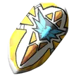

# Shield Slam 2

<!-- media:start (generated by scripts/build_media.py) -->
{ .lu-icon width="128" loading="lazy" }
<!-- media:end -->

[Player skills](./README.md) | [Methodology](./Methodology.md)

**Skill ID:** 565

## Description

Damage: 10. Makes you rush forward, doing 10 damage and knocking down the enemy that you strike.

Name and tooltip: official English client text (`locale.xml`, `en_US`).

**Historical community name:** Shield Rush 3. [Faction Gear, revision 163921](https://legouniverse.fandom.com/api.php?action=query&prop=revisions&revids=163921&rvprop=ids%7Ccontent&rvslots=main&formatversion=2&format=json) associates this name with Rank 3 Knight Shield; the local data associates [Knight Shield 3 (LOT 7404)](../items/7404.md) with skill 565. This indirect equipment match differs from the official client name, which takes precedence.

## Recorded settings

- **Imagination cost (client data):** 7
- **Cooldown value (client data):** 7

These are stored values, not measured live behavior; set bonuses and equipment casts can follow different server paths.

## Equipment associations

These items have an ObjectSkills cast-on-type 0 association and a supported equipment slot. Follow each item link for source and requirement evidence.

- [Knight Shield 3 (LOT 7404)](../items/7404.md) — slot `special_l`
- [Knight Shield 3 (LOT 12969)](../items/12969.md) — slot `special_l`

## Equipment-set associations

No qualifying set association was found.

A listed association does not establish that the skill, item, or set is obtainable or fully implemented in a particular deployment.
