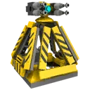

# Personal Fortress

<!-- media:start (generated by scripts/build_media.py) -->
{ .lu-icon width="128" loading="lazy" }
<!-- media:end -->

[Player skills](./README.md) | [Methodology](./Methodology.md)

**Skill ID:** 649

## Description

Damage: 1x16. Creates a fortified turret that attacks enemies.

Name and tooltip: official English client text (`locale.xml`, `en_US`).

## Recorded settings

- **Imagination cost (client data):** 10
- **Cooldown value (client data):** 30

These are stored values, not measured live behavior; set bonuses and equipment casts can follow different server paths.

## Equipment associations

These items have an ObjectSkills cast-on-type 0 association and a supported equipment slot. Follow each item link for source and requirement evidence.

- [Engineer Vest 3 (LOT 7417)](../items/7417.md) — slot `clavicle`
- [Engineer Vest 3 (LOT 12963)](../items/12963.md) — slot `clavicle`
- [Valiant Engineer's Cape (LOT 16182)](../items/16182.md) — slot `clavicle`

## Equipment-set associations

No qualifying set association was found.

A listed association does not establish that the skill, item, or set is obtainable or fully implemented in a particular deployment.
