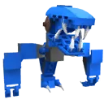

# Summon Scratch

<!-- media:start (generated by scripts/build_media.py) -->
{ .lu-icon .lu-on-light width="128" loading="lazy" }
<!-- media:end -->

[Player skills](./README.md) | [Methodology](./Methodology.md)

**Skill ID:** 673

## Description

Damage: 2x8. Creates Scratch, a creature who assists you in battle.

Name and tooltip: official English client text (`locale.xml`, `en_US`).

**Historical community name:** Scratch. [Faction Gear, revision 163921](https://legouniverse.fandom.com/api.php?action=query&prop=revisions&revids=163921&rvprop=ids%7Ccontent&rvslots=main&formatversion=2&format=json) associates this name with Rank 3 Summoner Shoulderpads; the local data associates [Summoner Shoulderpads 3 (LOT 7555)](../items/7555.md) with skill 673. This indirect equipment match differs from the official client name, which takes precedence.

## Recorded settings

- **Imagination cost (client data):** 10
- **Cooldown value (client data):** 30

These are stored values, not measured live behavior; set bonuses and equipment casts can follow different server paths.

## Equipment associations

These items have an ObjectSkills cast-on-type 0 association and a supported equipment slot. Follow each item link for source and requirement evidence.

- [Summoner Shoulderpads 3 (LOT 7555)](../items/7555.md) — slot `clavicle`
- [Summoner Shoulderpads 3 (LOT 12923)](../items/12923.md) — slot `clavicle`
- [Valiant Summoner's Cape (LOT 16183)](../items/16183.md) — slot `clavicle`

## Equipment-set associations

No qualifying set association was found.

A listed association does not establish that the skill, item, or set is obtainable or fully implemented in a particular deployment.
