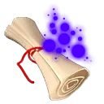

# Scanner

<!-- media:start (generated by scripts/build_media.py) -->
{ .lu-icon .lu-on-dark width="128" loading="lazy" }
<!-- media:end -->

[Player skills](./README.md) | [Methodology](./Methodology.md)

**Skill ID:** 776

## Description

Shows the location of dangerous enemies and collectibles on your mini-map.

Name and tooltip: official English client text (`locale.xml`, `en_US`).

## Recorded settings

- **Imagination cost (client data):** 0
- **Cooldown value (client data):** 0

These are stored values, not measured live behavior; set bonuses and equipment casts can follow different server paths.

## Equipment associations

No qualifying direct equipment association was found.

## Equipment-set associations

- **Set 20, 5 equipped pieces:** [Space Marauder Helm 2 (LOT 7449)](../items/7449.md), [Space Marauder Jacket 2 (LOT 7473)](../items/7473.md), [Space Marauder Pants 2 (LOT 7497)](../items/7497.md), [Space Marauder Blaster 2 (LOT 7521)](../items/7521.md), [Space Marauder Launcher 2 (LOT 7548)](../items/7548.md), [Space Marauder Shoulderpads 2 (LOT 8460)](../items/8460.md)

A listed association does not establish that the skill, item, or set is obtainable or fully implemented in a particular deployment.
