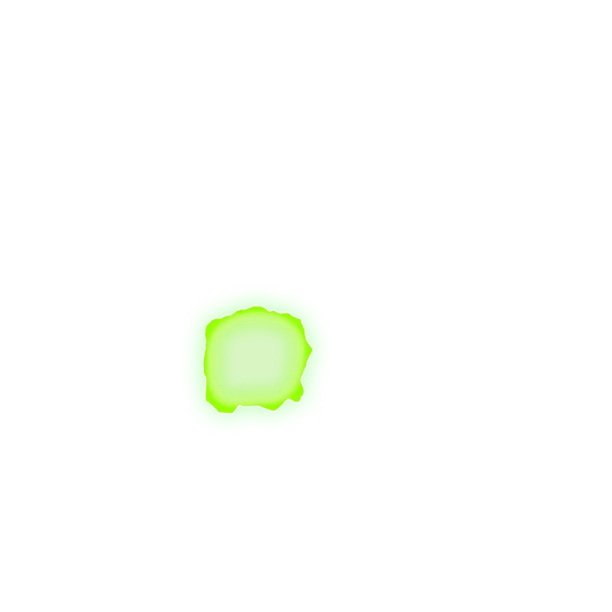

# Avant Grove — zone 1151

<!-- media:start (generated by scripts/build_media.py) -->
{ width="480" loading="lazy" }

*In-game minimap from the client (stitched from the minimap tiles).*
<!-- media:end -->

[Zones and maps](./README.md) | [Worlds guide](../Worlds%20Guide.md)

**Category:** Property. **Zone / instance ID:** 1151.

## Official client text

- **Name:** Avant Grove (`ZoneTable_1151_DisplayDescription`)
- **Release status:** Not flagged as fully released: ZoneTable `locStatus` 1. The client still ships an official localized name for it.

## Explore the evidence

This ID has a ZoneTable record in the local snapshot.

- [Quest locations](../quests/locations/zone-1151.md)
- [Item sources](../items/locations/zone-1151.md)

Quest associations can reflect an objective or mapped candidate, not necessarily a quest start. Item and pet coordinates are static map evidence, not guaranteed active spawns. See each linked page for conditions and limitations.
