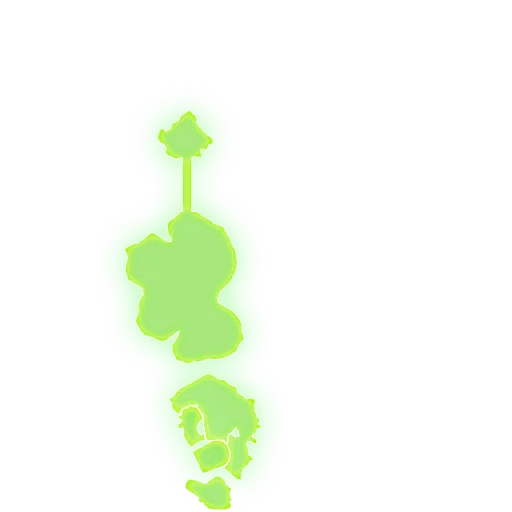

# Pet Cove — zone 1201

<!-- media:start (generated by scripts/build_media.py) -->
{ width="240" loading="lazy" }

*In-game minimap from the client (stitched from the minimap tiles).*
<!-- media:end -->

<!-- location-map:start (generated by scripts/build_location_maps.py) -->
## Location map

*Location overlay: its terrain-bounds projection is still provisional pending an in-game landmark check. Recorded XYZ values remain authoritative; NPC and enemy markers show potential spawn points, not live availability.*

Interactive map markers are loading. Their recorded coordinates remain available in the source documentation.

<!-- location-map:end -->

[Zones and maps](./README.md) | [Worlds guide](../Worlds%20Guide.md)

**Category:** World. **Zone / instance ID:** 1201.

## Official client text

- **Name:** Pet Cove (`ZoneTable_1201_DisplayDescription`)
- **Release status:** Released: ZoneTable `locStatus` 2.

## Explore the evidence

This ID has a ZoneTable record in the local snapshot.

- [Quest locations](../quests/locations/zone-1201.md)
- [Item sources](../items/locations/zone-1201.md)
- [Pet locations](../pets/locations/zone-1201.md)

Quest associations can reflect an objective or mapped candidate, not necessarily a quest start. Item and pet coordinates are static map evidence, not guaranteed active spawns. See each linked page for conditions and limitations.
