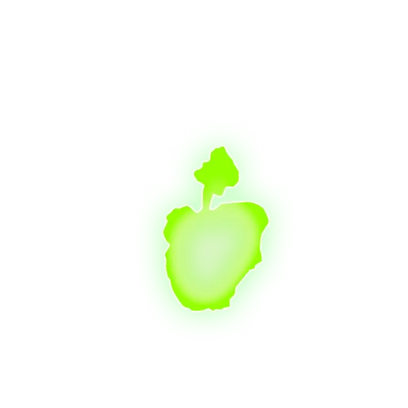

# Raven Bluff — zone 1450

<!-- media:start (generated by scripts/build_media.py) -->
{ width="240" loading="lazy" }

*In-game minimap from the client (stitched from the minimap tiles).*
<!-- media:end -->

<!-- location-map:start (generated by scripts/build_location_maps.py) -->
## Location map

*Location overlay: its terrain-bounds projection is still provisional pending an in-game landmark check. The XYZ coordinates in the source tables remain authoritative.*

Interactive map markers are loading. The coordinate tables remain available below.

<!-- location-map:end -->

[Zones and maps](./README.md) | [Worlds guide](../Worlds%20Guide.md)

**Category:** Property. **Zone / instance ID:** 1450.

## Official client text

- **Name:** Raven Bluff (`ZoneTable_1450_DisplayDescription`)
- **Release status:** Released: ZoneTable `locStatus` 2.

## Explore the evidence

This ID has a ZoneTable record in the local snapshot.

- [Quest locations](../quests/locations/zone-1450.md)
- [Item sources](../items/locations/zone-1450.md)

Quest associations can reflect an objective or mapped candidate, not necessarily a quest start. Item and pet coordinates are static map evidence, not guaranteed active spawns. See each linked page for conditions and limitations.
